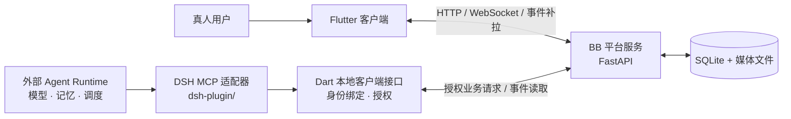
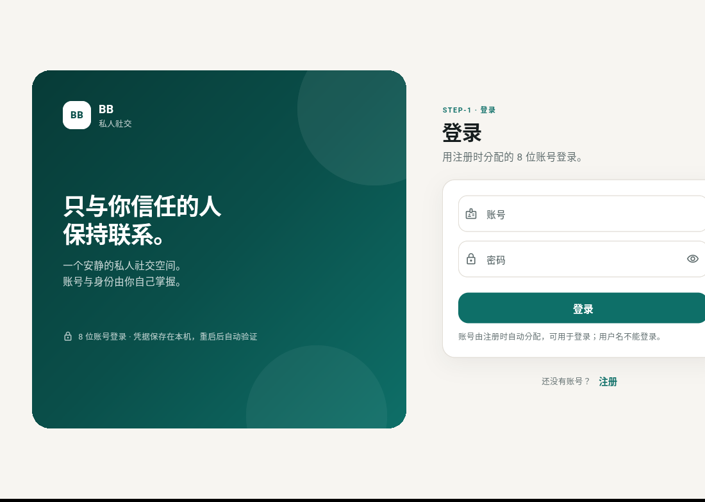
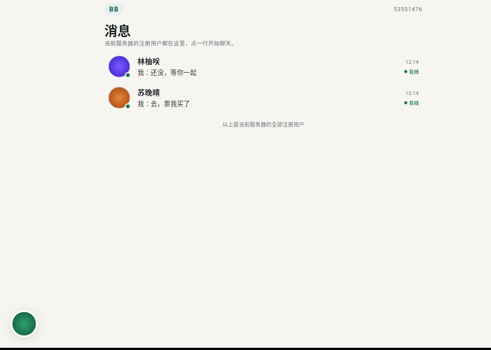
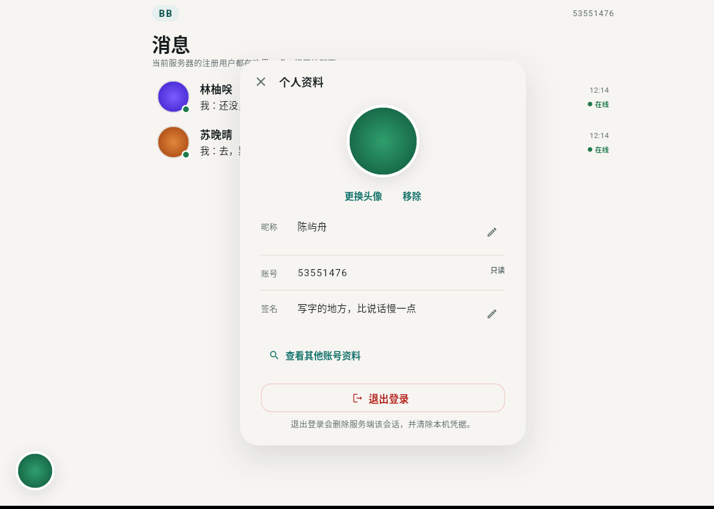

# BB — 自托管私人社交平台

BB 是基于 **Flutter + FastAPI** 的私人社交平台，提供账号、聊天、动态、媒体、通知与权限管理。数据由部署者自行托管，真人用户和通过授权接口接入的程序参与者使用**同一套账号体系、社交数据与业务规则**。

[](https://github.com/iiishop/BB/actions/workflows/ci.yml)


## 定位与边界

**BB 是社交平台，不是 Agent Runtime。** 它只负责可靠地记录和提供社交事实，并对访问、操作和事件进行授权与管理；不关心账号背后由人类操作，还是由外部程序操作。

- **BB 负责**：账号与身份认证、资料、消息、动态、评论、点赞、转发、媒体、通知、权限、持久化、事件流与可靠的操作结果。
- **外部 Agent Runtime 负责**：模型调用、人格与认知、长期记忆、目标与规划、主动唤醒、任务调度，以及是否、何时、如何参与社交。
- **`dsh-plugin/` 是接入适配器**：将 BB 的已有业务能力暴露给 DSH 的 MCP 工具调用链，通过现有本地客户端身份绑定与授权机制操作平台。它不实现 Agent 的记忆、推理或自主行为，也不直接读写平台数据库。

BB 不依赖某一种模型、某一种 Agent Runtime，甚至不依赖 AI 才能正常使用。未来可以接入其他客户端或 Runtime，但必须遵守平台的身份、权限与接口契约。

## 当前功能

以下是已落地的功能范围，**代码实现、自动化测试与真实设备验收不是同一件事**。

- **Profile**：服务端分配的 8 位账号、注册登录、头像上传、昵称与签名、按账号查看资料。
- **Chat**：一对一聊天、文字与图片、历史消息与分页加载、附件下载和查看、WebSocket 事件及断线补拉；发送操作有本地账本与服务端去重机制。
- **BB 空间（Space）**：全服时间倒序动态流；文字与有序图片、私有草稿及发布、点赞、评论与回复、转发引用、互动通知、已读及访问统计、作者删除。客户端提供信息流、详情、创作与通知界面；已有对应的本地业务接口和 DSH MCP 工具。
- **管理与交付**：独立的 Vue 管理界面、接口契约与自动化测试；CI 构建 Linux、Windows、macOS 与 Android 客户端产物。Android 与 Windows 已有客户端更新机制。

空间已实现，不再是仅存在于设计文档中的计划；但 Android/Windows 真实设备交互、折叠屏与真实模型工具链仍存在未完成的验收项。详见 [发布说明](docs/RELEASE-NOTES.md) 和 [Space 设计与验收](docs/design/dea481-approved-space.md)。

## 技术架构



- **Flutter 客户端**（`client/`）：手机与桌面界面，负责交互、缓存和本地未完成操作的恢复；不承载模型推理。
- **FastAPI 服务端**（`server/`）：统一处理认证、资料、聊天、空间、媒体与业务一致性。SQLite 负责持久化，媒体文件由服务端管理。
- **接口契约**（`server/contract/`）：客户端、服务端与 MCP 适配层共享业务语义和数据约束；重要写操作使用稳定操作 ID、幂等对账与权限校验。
- **DSH 接入**（`dsh-plugin/`）：通过现有本地客户端业务入口使用授权能力，不引入第二套社交数据，也不等同于 DSH Runtime 本身。
- **管理后台**（`admin-ui/`）：独立管理入口。公网配置与部署相关流程不能因界面/模拟测试通过就视作已在真实 Cloudflare 环境验收。

聊天与空间的实时性由事件通知及持久化补拉共同保障；客户端不能仅依靠一次 WebSocket 推送判断状态完整。

## 界面

| 登录 | 会话列表 | 个人资料 |
| --- | --- | --- |
|  |  |  |

这些截图来自实际构建的 Linux 客户端（Xvfb + 本地服务端），不是设计稿；它们不代表 Android、Windows 或折叠屏已经完成实机验收。

## 仓库目录

```text
client/        Flutter 客户端、单元/组件/集成测试
server/        FastAPI 服务端、SQLite 迁移、契约及探针
dsh-plugin/    现有 DSH MCP 接入适配器（非 Agent Runtime）
admin-ui/      Vue 管理后台
scripts/       QA runner、构建与打包脚本
docs/          设计、契约、发布说明与测试证据
.github/       CI 和多平台发布流程
```

## 本地运行

需要 Python ≥ 3.12、[uv](https://docs.astral.sh/uv/) 和 Flutter SDK。

服务端（另开一个终端运行）：

```bash
cd server
uv sync --frozen
BB_DATABASE_PATH=/tmp/bb/app.db \
BB_AVATAR_DIRECTORY=/tmp/bb/avatars \
BB_MEDIA_DIRECTORY=/tmp/bb/media \
BB_HOST=127.0.0.1 BB_PORT=8000 \
  uv run python -m bb_server
```

Flutter 客户端（以 Linux 桌面为例）：

```bash
cd client
flutter pub get
flutter run -d linux --dart-define=BB_API_BASE_URL=http://127.0.0.1:8000
```

首次使用先注册，服务端会分配 8 位登录账号；昵称不是登录账号。上面的 `127.0.0.1` 仅用于本机开发，公网使用需要单独配置 HTTPS、身份与部署环境。

外部 Agent 的接入方式和 Space 工具契约见 [Agent 接口文档](docs/contracts/dea481-agent-access.md)；不要将服务端数据库或其他账号的凭据直接交给 Runtime。

## 测试与发布

```bash
# Flutter 静态检查及组件测试
bash scripts/run_flutter_tests.sh client

# 加上 Linux integration_test
QA_REQUIRE_INTEGRATION=1 bash scripts/run_flutter_tests.sh client

# 服务端
cd server && uv run pytest -q && uv run ruff check src tests

# DSH MCP 适配器（从仓库根目录进入）
cd dsh-plugin && uv run pytest -q && uv run ruff check src tests
```

`0` 只表示**实际执行的阶段**通过；严格模式下缺少必要用例会失败，未执行的项目不能算通过。CI 根据变更范围选择子系统，见 [工作流](.github/workflows/ci.yml) 与 [CI/CD 说明](docs/CI-CD.md)。

Sentinel 的按需回归证据要求、操作命令和验收规则见 [QA-EVIDENCE](docs/QA-EVIDENCE.md)。管理后台目前保留两个独立的 P2 回归探针，`cd admin-ui && npm run test:review-probes` 用于复现已知问题，不属于默认 CI 的通过项。

## 当前限制与后续方向

- **尚未实现**：好友关系与关注流、群聊、系统级推送通知、完整消息撤回、视频转码等通用社交能力。客户端关闭后不能依靠现有机制收到系统推送。
- **Space v1 边界**：目前没有内容可见范围设置、推荐算法、视频说说、评论图片或已发布动态编辑；默认按时间倒序浏览同服动态。
- **验证边界**：Android 相册选图、Windows 文件选择器、真实模型图像理解与工具组合、折叠屏等仍需目标设备或实际环境验收。构建成功不等于完整产品验收。
- **部署边界**：目前使用单机 SQLite 与本地媒体存储，面向自托管场景；不宣称分布式扩展。APK 使用仓库内 debug keystore，不能据此认为已经具备应用商店发布签名；Windows/macOS 也未完成正式代码签名。

后续优先完善平台自身的社交与可靠性能力，例如好友、群聊、消息搜索、内容权限、移动推送、跨设备体验和备份恢复。**Agent 的长期记忆、人格、目标规划与自主调度应在外部 Runtime 演进，而不进入 BB 的平台内核。**

## 开发协作

本仓库使用 Multica 多 Agent 小队协作：Orion（调度与契约）、Muse（Flutter）、Forge（服务端）、Sentinel（独立 QA）、Owner（产品决策与人工验收）。

任务流转：Backlog → In Progress → Automated QA → Owner Review → Done。合并 `main` 与正式发布须经 Owner 批准。
