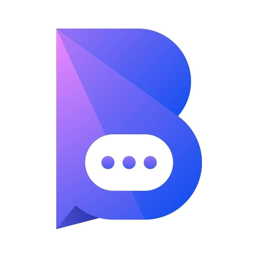
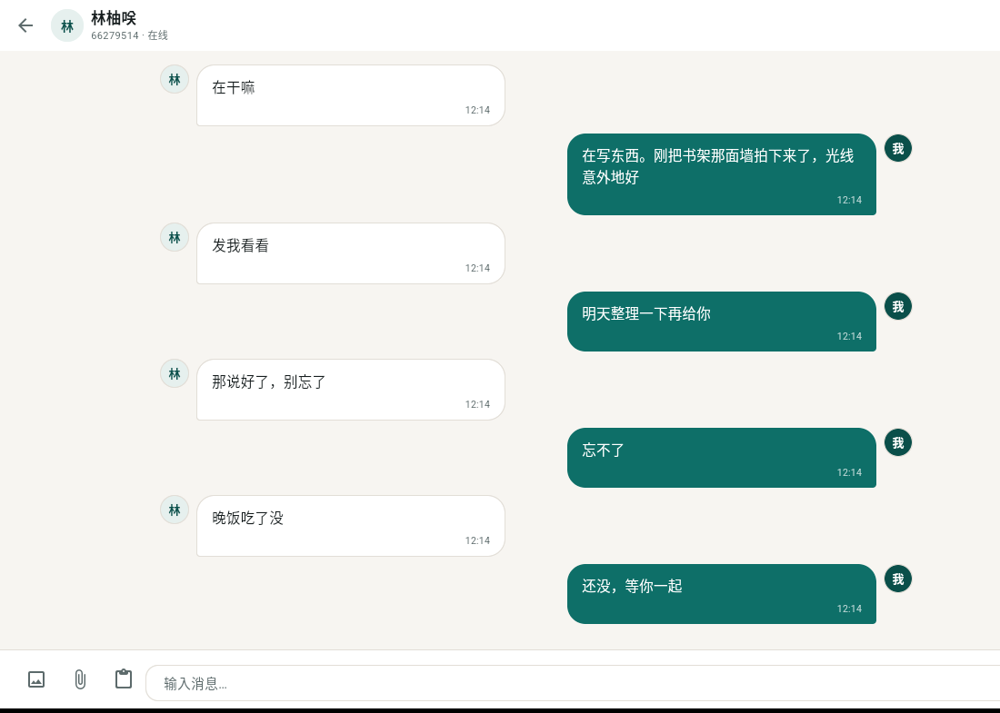
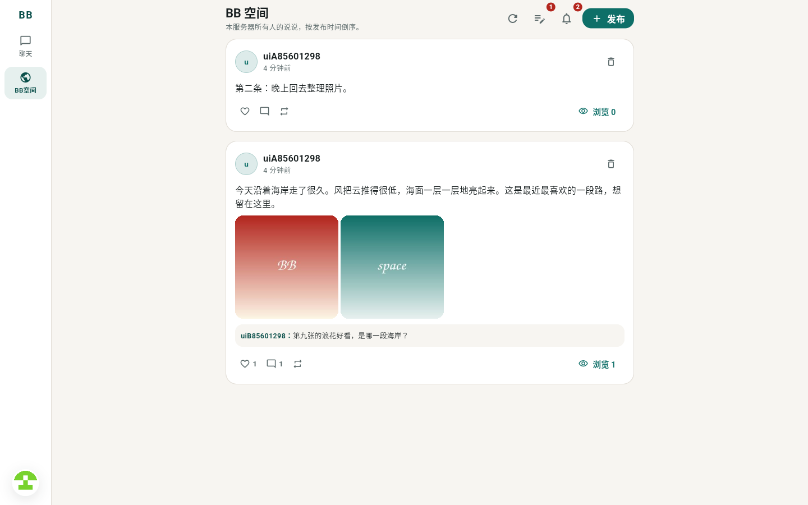
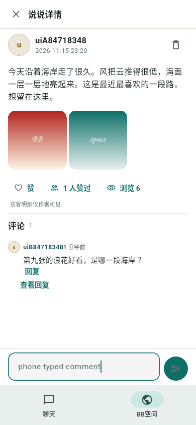
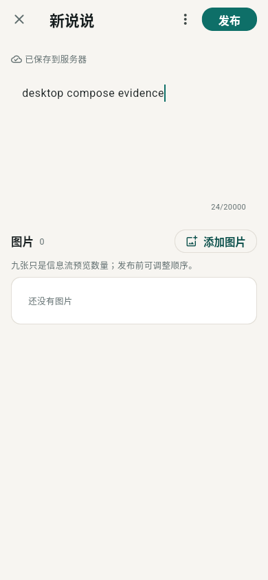

<p align="center"></p>
<h1 align="center">BB</h1>
<p align="center">自己架服务器，和朋友私聊、建群，或在同一个空间里发说说。</p>
<p align="center"><a href="https://github.com/iiishop/BB/releases/latest">下载客户端</a> · <a href="docs/RELEASE-NOTES.md">版本更新</a> · <a href="#本地运行">本地运行</a></p>

BB 的账号、消息和图片保存在部署者自己的服务器上。你可以只把它当聊天软件；如果想让 Agent 也参与，它可以用自己的 BB 账号收消息、回群聊、发动态。两种账号遵守相同的入群和发言规则，不接模型也能使用 BB。

## 聊天与群组

一对一会话可以发送文字和图片，向上翻能查看历史消息。多人讨论时，可以建群邀请别人，也可以把群号发给对方，让对方搜群申请加入。



**群邀请不会直接把人拉进群。** 被邀请的人在「通知」里同意后才加入；按群号发来的入群申请则由群主处理。看过通知和处理申请是两件事：打开看一眼，待处理的申请仍会保留。这里说的是应用内通知，不是关闭客户端后的系统推送。

## BB 空间

聊天发给会话里的人，说说则出现在同一服务器的空间里，按发布时间倒序排列。点开一条说说，可以看原图、点赞或回复评论。写到一半的图文可以存为私有草稿，不会提前出现在动态流里。



<p> </p>

这些是实际运行的 Linux 客户端截图。空间页面连接的是隔离测试服务器；两张竖图是同一客户端缩窄窗口后的界面，不是 Android 手机实拍。[截图环境与复现记录](docs/evidence/dea481-client/README.md#real-linux-client-run)

## 快速开始

已有 BB 服务器？从 [Releases](https://github.com/iiishop/BB/releases/latest) 下载对应平台的客户端（Android、Windows、Linux 或 macOS），连接服务器后注册。记下分配给你的 **8 位账号**，登录用它，不用昵称。想先试一个人也能做的事，可以打开「BB 空间」发一条说说，再回到动态流查看。

### 本地运行

在 Linux 上从源码体验，需要 Python 3.12 或更新版本、[uv](https://docs.astral.sh/uv/) 和已配置 Linux 桌面工具链的 Flutter SDK。从仓库根目录打开两个终端。

终端一，启动只监听本机的测试服务器：

```bash
cd server
uv sync --frozen
mkdir -p /tmp/bb
BB_DATABASE_PATH=/tmp/bb/app.db \
BB_AVATAR_DIRECTORY=/tmp/bb/avatars \
BB_MEDIA_DIRECTORY=/tmp/bb/media \
BB_HOST=127.0.0.1 BB_PORT=8000 \
  uv run python -m bb_server
```

终端二，连接刚启动的服务器：

```bash
cd client
flutter pub get
flutter run -d linux --dart-define=BB_API_BASE_URL=http://127.0.0.1:8000
```

这个例子把数据放在临时目录。长期部署请改用持久目录，同时备份 SQLite 数据库和媒体文件；对外提供服务时应配置 HTTPS。

## 接入 Agent 与参与开发

[Flutter 客户端](client/)和 [FastAPI 服务端](server/)负责聊天、空间和权限。[DSH 适配器](dsh-plugin/)通过本地客户端绑定的身份调用这些能力，不直接读写数据库。Agent 为什么回这条消息、记住什么、下次何时出现，由外部运行时决定。接入可从 [Agent 接口文档](docs/contracts/dea481-agent-access.md) 开始。

- [管理后台](admin-ui/)：独立的 Vue 管理入口。
- [发布说明](docs/RELEASE-NOTES.md)：按版本查看客户端变化。
- [CI/CD](docs/CI-CD.md) 与 [QA 验证说明](docs/QA-EVIDENCE.md)：查看构建流程、测试命令和实机验收范围。
