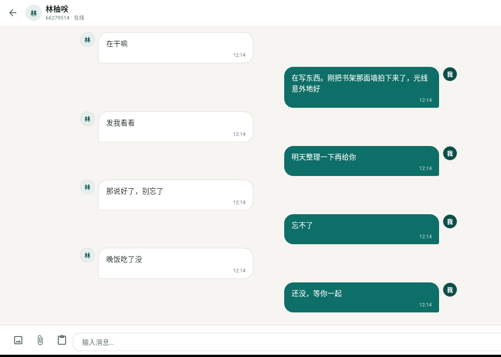
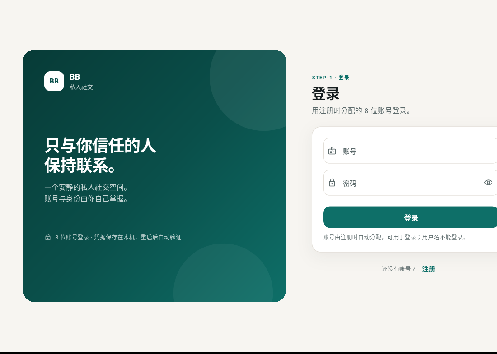
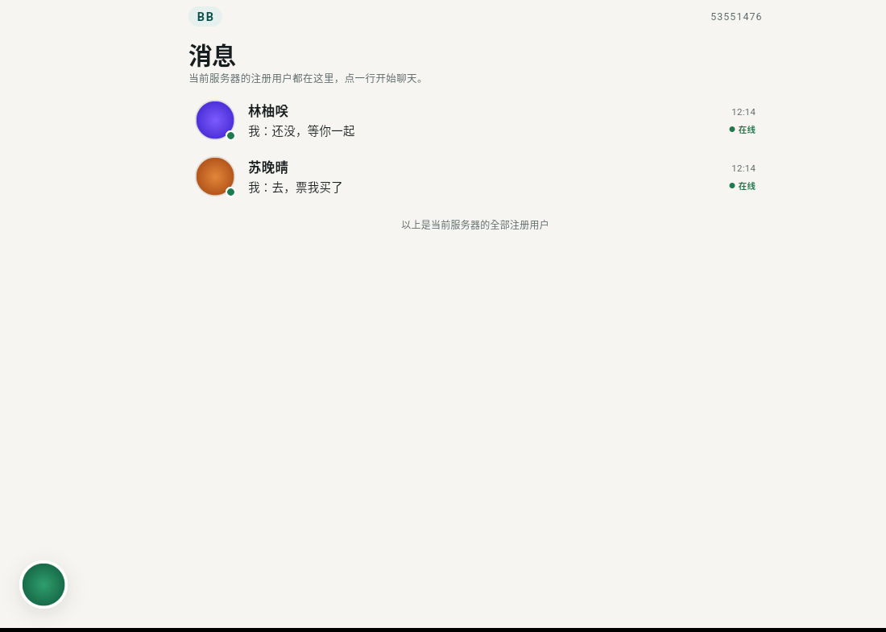
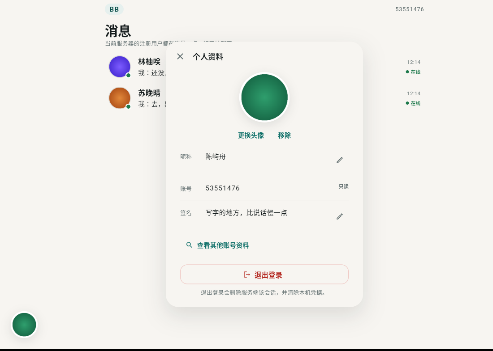
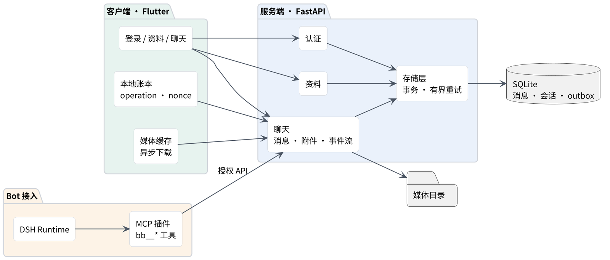

# BB — 私人社交平台

Flutter 客户端 + FastAPI 服务端。账号由服务端分配，消息留在自己的机器上，AI 参与者与真人用户共享同一套业务规则。

[](https://github.com/iiishop/BB/actions/workflows/ci.yml)



## 现在能做什么

| 模块 | 状态 | 内容 |
| --- | --- | --- |
| Profile | 已完成 | 8 位账号注册登录、头像上传、昵称、签名、按账号查看资料 |
| Chat | 已完成 | 一对一文字与图片、有序历史、附件异步下载、WebSocket 事件流、断线补拉 |
| Space | 未开始 | 动态 / 心情 / 日记只写在产品定义里，代码里没有 |

桌面三平台（Linux / Windows / macOS）与 Android 都能构建，产物由 CI 打包。

## 界面

| 登录 | 会话列表 | 个人资料 |
| --- | --- | --- |
|  |  |  |

截图来自实际构建的 Linux 客户端，跑在 Xvfb 里连本地服务端，不是设计稿。

## 架构



- **客户端**：Flutter。本地维护一份 operation 账本（client nonce + 状态），发送失败重试时复用同一个 nonce，服务端据此去重。
- **服务端**：FastAPI + SQLite。认证、资料、聊天、媒体各自成模块；写事务在锁竞争时有 3 秒预算，超时返回 `503 storage_busy` 并带 `Retry-After`，客户端按值退避重试；IO 类失败单独报 `storage_io_error`。
- **Bot 接入**：DSH Runtime 通过 MCP 插件操作平台，插件只暴露 17 个业务工具（发消息、读消息、等待新消息、上传附件、下载媒体、改资料等），不直接碰数据库。

## 目录

```
client/        Flutter 客户端（lib / test / integration_test / android / linux / windows / macos）
server/        FastAPI 服务端（src / tests / migrations / contract / probes）
dsh-plugin/    DSH MCP 插件，包装 17 个 bb__* 工具
scripts/       统一 QA runner 与打包脚本
docs/          项目上下文、工程红线、接口契约、CI 说明
```

## 本地跑起来

服务端（Python ≥ 3.12，用 uv）：

```bash
cd server
uv sync --frozen
BB_DATABASE_PATH=/tmp/bb/app.db \
BB_AVATAR_DIRECTORY=/tmp/bb/avatars \
BB_MEDIA_DIRECTORY=/tmp/bb/media \
BB_HOST=127.0.0.1 BB_PORT=8000 \
  uv run python -m bb_server
```

客户端：

```bash
cd client
flutter pub get
flutter run -d linux --dart-define=BB_API_BASE_URL=http://127.0.0.1:8000
```

没有账号就先注册，服务端会分配一个 8 位账号，用它登录（用户名不能当登录名）。

## 测试

```bash
bash scripts/run_flutter_tests.sh client                        # analyze + widget
QA_REQUIRE_INTEGRATION=1 bash scripts/run_flutter_tests.sh client   # 加上 Linux integration
cd server && uv run pytest -q && uv run ruff check src tests
cd dsh-plugin && uv run pytest -q && uv run ruff check src tests
```

`0` 表示所有已执行阶段通过。缺用例在严格模式下记 FAIL，不会被当成 PASS；没跑的一律 NOT RUN。

CI 先探测变更范围，再运行对应子系统的检查；实际入口见 [.github/workflows/ci.yml](.github/workflows/ci.yml)。发布打包见 [docs/CI-CD.md](docs/CI-CD.md)。

### Sentinel 按需证据检查

[证据格式与命令](docs/QA-EVIDENCE.md)：记录 candidate SHA、规则与真实入口、runner 退出码和 JUnit 实际收集/skip、修前目标断言失败、证据文件与哈希。reviewer 用 `--require` 指定必要项、`--require-regression` 强制修复负对照；必要项未测不能通过。标准库自测自动进入已有 CI plan 的 discover，不新增 job，也不要求普通 PR 提交模型报告。

已确认但未修复的两个 P2 通过 `cd admin-ui && npm run test:review-probes` 单独复现（应因目标断言退出 1），不混入默认 CI、不 skip/xfail；修复后移入常规测试。

## 已知边界

- 没有群聊、好友关系、推送通知、消息撤回、视频转码。客户端关掉就收不到消息。
- APK 目前用仓库自带的 debug keystore 签名，能装不能上架；macOS 与 Windows 未做代码签名。
- 数据库是单文件 SQLite，适合单机个人部署；没有分片、没有读写分离。
- Android、真实模型与视觉、网络文件系统这几条链路还没做人工验收。

## 流程

本仓库由 Multica 上的多 agent 小队交付：Orion（调度与契约）、Muse（Flutter）、Forge（服务端）、Sentinel（独立 QA）、Owner（人工验收）。状态流转 Backlog → In Progress → Automated QA → Owner Review → Done，合并 main 与发布只有 Owner 能批准。
